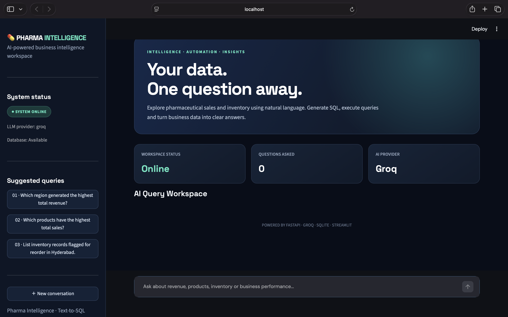
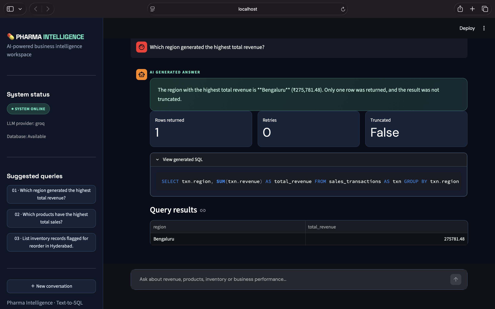
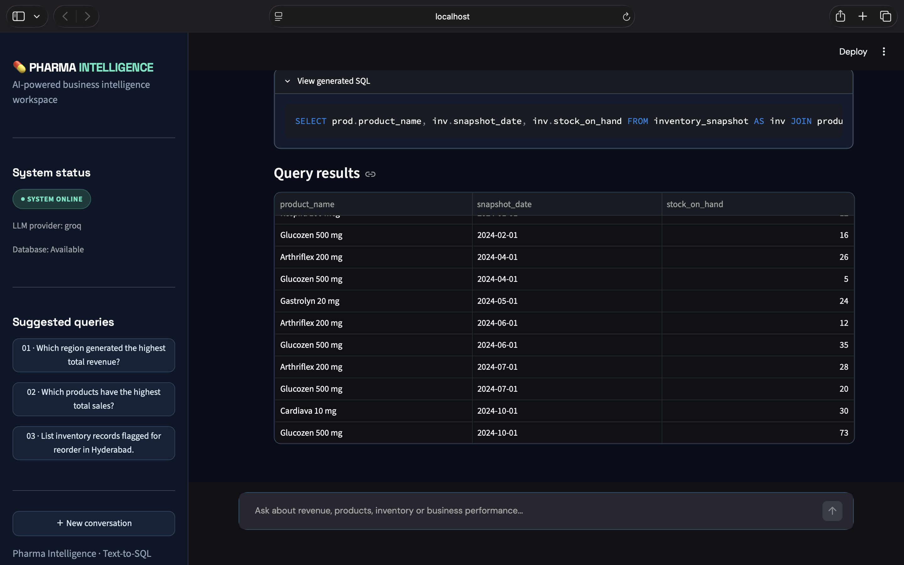
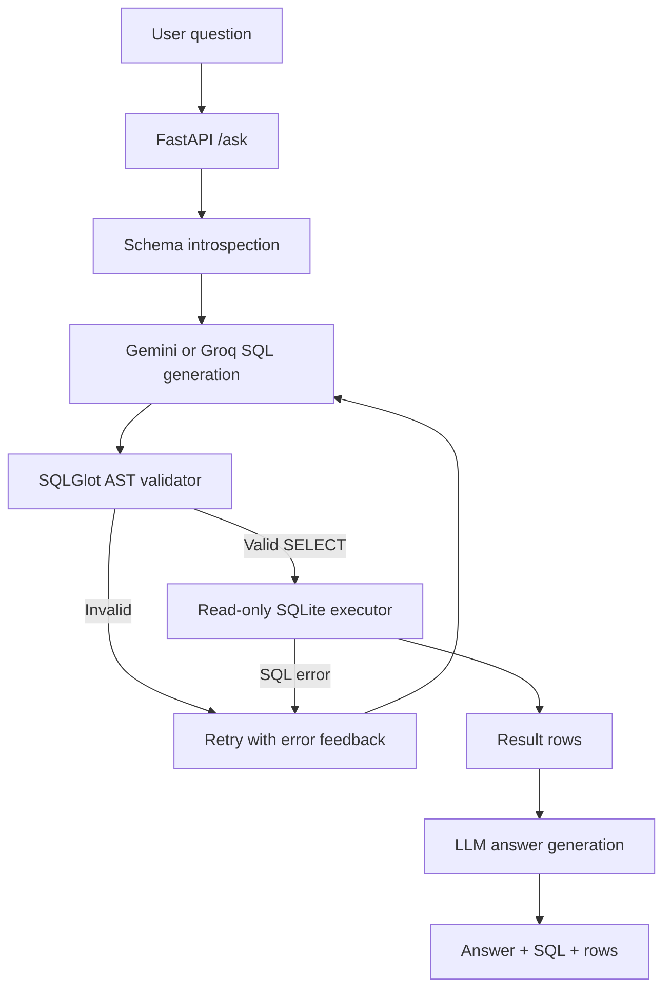

# Pharma Text-to-SQL Agent

A schema-aware natural-language-to-SQL application for a **synthetic** pharmaceutical distributor database. It uses FastAPI, SQLite, SQLGlot, and either Google Gemini or Groq. The security design is intentionally conservative: generated SQL is parsed, restricted to a single read-only SELECT query, capped with a LIMIT, then executed against a SQLite connection opened in read-only mode.

> The database is generated sample data. It is not real Sanofi, patient, customer, or commercial data.

## Features

- Natural-language questions translated into SQLite SQL using a live Gemini or Groq API.
- Schema-aware prompt containing table names, columns, types, and relationships.
- SQLGlot AST validation rather than keyword-only filtering.
- Rejects writes, DDL, administrative statements, multiple statements, SQL comments, malformed SQL, and unsafe CTE/subquery contents.
- Adds or caps `LIMIT` at `MAX_QUERY_ROWS`.
- Read-only SQLite connection, `PRAGMA query_only`, VM execution timeout, and response row cap.
- Up to two SQL correction retries after the first attempt.
- Plain-English answer generated from the original question and returned rows.
- FastAPI `/health`, `/schema`, and `/ask` endpoints, plus basic in-process rate limiting.
- Modern Streamlit dashboard with conversational queries, generated SQL, KPI cards, and interactive result tables.
- Mocked tests. The test suite does not call a real LLM API.
- 20-question evaluation runner that records measured execution success, result matches, retry count, and failures.

## Application Screenshots

### Dashboard


### AI-generated answer


### Generated SQL and query results


## Frontend

The application includes a Streamlit-based user interface connected to the FastAPI backend.

Frontend capabilities:
- Natural-language chat interface.
- Suggested pharmaceutical analytics questions.
- Live backend and database status.
- AI-generated SQL with syntax highlighting.
- Query metrics including rows returned, retries, and truncation.
- Tabular presentation of database results.

Frontend technologies: Streamlit, Pandas, HTTPX, and custom CSS.

## Architecture



## Database

The database contains three tables:

| Table | Purpose |
|---|---|
| `products` | Product names, categories, unit costs, list prices, reorder levels |
| `sales_transactions` | Synthetic sales date, product, region, units, revenue, estimated gross profit, margin |
| `inventory_snapshot` | Periodic regional stock snapshots and reorder flags |

The deterministic generator creates 8 products, 600 sales transactions and 768 inventory snapshots.

## Setup (macOS / VS Code)

Run commands from the repository root, `text-to-sql-agent`:

```bash
python3 -m venv .venv
source .venv/bin/activate
python -m pip install -r requirements-dev.txt
cp .env.example .env
```

Open `.env` and set one provider:

### Gemini

```dotenv
LLM_PROVIDER=gemini
LLM_API_KEY=your_gemini_api_key
LLM_MODEL=gemini-3.8-flash
```

### Groq

```dotenv
LLM_PROVIDER=groq
LLM_API_KEY=your_groq_api_key
LLM_MODEL=openai/gpt-oss-20b
```

Model availability can change by provider. Use a model ID currently enabled in your provider account. Never commit `.env` or paste the API key into source code, GitHub, screenshots, or chat.

The project defaults to `data/pharma.db`. To recreate the synthetic dataset:

```bash
PYTHONPATH=src python scripts/create_database.py
PYTHONPATH=src python scripts/print_schema.py
```

## Run locally

```bash
PYTHONPATH=src python -m uvicorn app.main:app --reload --port 8000
```

Open the interactive API documentation at `http://127.0.0.1:8000/docs`.

### Launch the Streamlit frontend

Keep the FastAPI backend running. Open a second terminal, activate the virtual environment, and run:

```bash
streamlit run streamlit_app.py
```

Open the local URL printed by Streamlit, usually `http://localhost:8501`.

The frontend communicates with the backend at `http://localhost:8000` by default. To override this, set the `API_BASE_URL` environment variable.

### API examples

Health:

```bash
curl http://127.0.0.1:8000/health
```

Schema:

```bash
curl http://127.0.0.1:8000/schema
```

Natural-language query:

```bash
curl -X POST http://127.0.0.1:8000/ask \
  -H 'Content-Type: application/json' \
  -d '{"question":"Which region generated the highest total revenue?"}'
```

The `/ask` response contains the original question, validated SQL, plain-English answer, rows, row count, truncation flag and retry count.

## SQL safety model

The SQL validator uses SQLGlot to parse input into an abstract syntax tree (AST). It does not rely on a fragile list of blocked words. It verifies that exactly one query is present, that its root is a SELECT or SELECT set operation, and that no write or administrative AST node appears anywhere in the expression tree. SQL comments are rejected to remove a common obfuscation surface. Parse failures are rejected.

A configured LIMIT is added or reduced to `MAX_QUERY_ROWS`. SQL is then executed through a SQLite URI with `mode=ro`, with `PRAGMA query_only = ON`, a progress-handler timeout and an additional result-row cap. This is defense in depth, not a claim that an LLM output is trusted.

## Tests and lint

```bash
python -m pytest -q
python -m ruff check .
python -m compileall -q src tests scripts
```

Tests use temporary SQLite files and stub/mock LLM responses. They do not call Gemini or Groq and do not use your real API key.

## Evaluation

After configuring an API key, run:

```bash
PYTHONPATH=src python scripts/run_evaluation.py
```

The 20-question benchmark compares the generated query's result rows against rows returned by reference SQL queries. It reports execution success, result matches, average retries and failures. It writes actual run results to `reports/eval_results.md` and `reports/eval_results.json`.

Latest recorded benchmark run:
- Questions attempted: 20/20
- Successful executions: 20/20
- Correct result matches: 20/20
- Result-match rate: 100%

These results apply only to the included 20-question benchmark and synthetic dataset. They do not establish production-grade accuracy or generalization.

## Docker

```bash
docker build -t pharma-text-to-sql .
docker run --rm -p 8000:8000 --env-file .env pharma-text-to-sql
```

## Configuration

| Variable | Default | Purpose |
|---|---|---|
| `LLM_PROVIDER` | `gemini` | `gemini` or `groq` |
| `LLM_API_KEY` | empty | Provider key, kept in local `.env` |
| `LLM_MODEL` | provider default | Provider model ID override |
| `DATABASE_PATH` | `data/pharma.db` | SQLite database file |
| `MAX_QUERY_ROWS` | `200` | Hard row limit, configured maximum 5,000 |
| `QUERY_TIMEOUT_SECONDS` | `3` | SQLite VM execution timeout |
| `RATE_LIMIT_REQUESTS` | `20` | `/ask` requests per client window |
| `RATE_LIMIT_WINDOW_SECONDS` | `60` | Rate-limit window |
| `MAX_OUTPUT_TOKENS` | `500` | LLM response token cap |
| `ALLOWED_ORIGINS` | `http://localhost:5173` | Comma-separated CORS origins |

The rate limiter is process-local. For multi-worker or production deployment, use a shared rate limiter and add authentication, stronger network controls, database backups and monitoring.

## Limitations and next steps

- Synthetic data is small and does not represent real pharma operations.
- Text-to-SQL quality depends on the selected model and question phrasing.
- Row-equivalence evaluation is limited to 20 fixed questions and this database.
- The API has no user authentication in this portfolio version.
- Add a production-grade shared rate limiter, audit logging, provider cost telemetry, and broader adversarial testing before exposing it publicly.

## License

MIT. See `LICENSE`.
